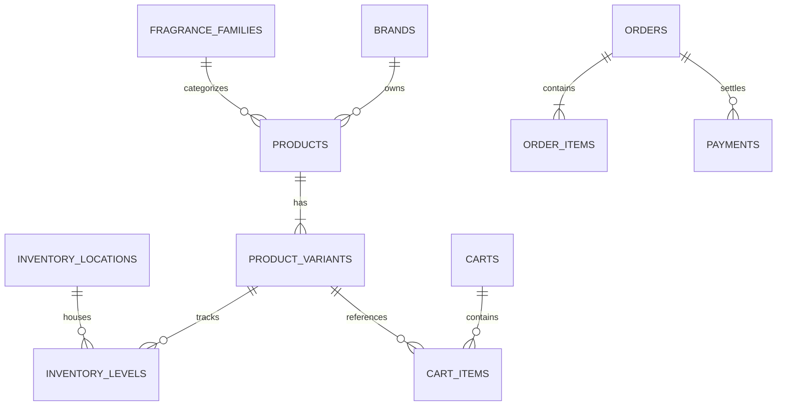

# SOLURE SCENTS
## Comprehensive Project Audit, Technical Assessment & Sprint Development Roadmap

---

### 1. Executive Summary

Solure Scents is an enterprise-grade luxury e-commerce platform dedicated to niche, artisanal, and high-concentration fine fragrances. The project is implemented using modern full-stack web technologies: **Next.js 16.2.10 (App Router)**, **React 19.2.4**, **TypeScript 5**, **Tailwind CSS v4**, **Framer Motion 12**, and **Supabase (PostgreSQL 15 with Row Level Security)**.

The codebase exhibits high engineering rigor in its relational database architecture, type safety, and security boundary isolation. However, there is a fundamental architectural transition underway:
1. **The Original Architectural Baseline (Phases 1–3)** assumed an authenticated customer model with customer profiles, password accounts, and user-bound carts.
2. **The Current Business Requirement** mandates a **guest-first, email-based e-commerce model** where consumers purchase directly without passwords or account registration, while authentication is strictly reserved for administrative operations and staff.

**Core Audit Findings:**
* **Storefront Experience:** The public storefront boasts luxury visual design, dynamic animations, and an interactive 3-step Scent Consultation engine (`/discovery`).
* **Cart & Checkout Blocker:** The current cart service (`cart-service.ts:L9`) throws an error if an unauthenticated user attempts to add an item (`"Authentication is required to update a cart"`). The checkout page (`/checkout/page.tsx:L2`) redirects anonymous users to sign in. **Guest consumers cannot currently complete a purchase.**
* **Payment Execution:** The payment subsystem (`payment-gateway-registry.ts:L3-L19`) is architected as an abstract provider-neutral registry that deliberately fails closed until a live gateway adapter (e.g., Paystack/Stripe) is registered.
* **Admin Operations Suite:** Fully built with an executive Command Centre, Product Catalogue manager, Guest Customer directory, Order Fulfillment desk with carrier dispatch tracking, and Inventory stock movement logging.
* **Code Quality & Health:** The codebase compiles with zero lint errors and passes `tsc --noEmit` and Next.js 16 route type generation with **zero errors**.

---

### 2. Actual Technology Stack

`VERIFIED:` Inspected directly from `package.json` and lockfile.

| Category | Technology | Version | Purpose in Codebase |
| :--- | :--- | :--- | :--- |
| **Framework** | Next.js (App Router) | `16.2.10` | Full-stack server rendering, route typegen, server actions, request proxy |
| **UI Library** | React / React DOM | `19.2.4` | Modern React 19 concurrent features, Server Components, Server Actions |
| **Language** | TypeScript | `^5.0` | Strict type checking with `next typegen && tsc --noEmit` |
| **Styling** | Tailwind CSS / PostCSS | `^4.0` | Utility styling with `@tailwindcss/postcss` and PostCSS `8.5.19` |
| **Animation** | Framer Motion | `^12.42.2` | Luxury scroll choreography, hero reveal transitions, modals, and drawers |
| **Icons** | Lucide React | `^1.24.0` | Vector UI icons for commerce, navigation, status, and administration |
| **Database & Auth** | Supabase SSR & JS | `@supabase/ssr: ^0.12.3`, `@supabase/supabase-js: ^2.110.6` | PostgreSQL client, server cookies, RLS queries, RPC stored procedures |
| **Data Fetching** | TanStack React Query | `^5.101.2` | Client asynchronous caching (installed; majority of current flows use SSR) |
| **Forms & Schemas** | Zod / React Hook Form | `zod: ^4.4.3`, `react-hook-form: ^7.81.0` | Trust-boundary input validation, type inference, form management |
| **Utilities** | clsx / tailwind-merge | `clsx: ^2.1.1`, `tailwind-merge: ^3.6.0` | Dynamic class merging |
| **Linting** | ESLint | `^9.0`, `eslint-config-next: 16.2.10` | Static code analysis with zero-warning constraint |

---

### 3. Project Directory Structure

`VERIFIED:` Extracted from workspace directory analysis.

```
SolureScents-main/
├── .env.example                     # Reference environment variables
├── .env.local                       # Active local Supabase configuration
├── AGENTS.md                        # Next.js 16 architecture guidelines
├── next.config.ts                   # Next.js configuration
├── package.json                     # Dependency manifests & quality scripts
├── postcss.config.mjs               # Tailwind CSS v4 PostCSS configuration
├── tsconfig.json                    # Strict TypeScript configuration
├── docs/
│   ├── commerce-domain.md           # Catalogue, money, inventory, and order invariants
│   ├── security-and-access.md       # Identity, RBAC, and storage rules
│   └── technical-audit-and-roadmap.md # This audit report & technical reference
├── public/
│   └── images/                      # High-resolution brand photography & editorial assets
├── src/
│   ├── proxy.ts                     # Request boundary (Next.js 16 proxy) for auth & sessions
│   ├── app/                         # App Router root and application boundaries
│   │   ├── (admin)/admin/           # Enterprise operations boundary
│   │   │   ├── analytics/           # 30-day commercial metrics & trend graphs
│   │   │   ├── customers/           # Guest shopper directory & email contacts
│   │   │   ├── inventory/           # Multi-location stock allocation & movements
│   │   │   ├── orders/              # Order status & courier fulfillment desk
│   │   │   ├── payments/            # Offline payment ledger & preparation
│   │   │   ├── products/            # Catalogue flacon & variant management
│   │   │   ├── settings/            # Commerce identity & security status
│   │   │   ├── layout.tsx           # Admin shell with mobile navigation drawer
│   │   │   └── page.tsx             # Real-time Command Centre dashboard
│   │   ├── (auth)/                  # Staff authentication entrance
│   │   │   ├── login/               # Administrator sign-in portal
│   │   │   ├── register/            # Staff provisioning notification notice
│   │   │   ├── forgot-password/     # Password recovery
│   │   │   ├── reset-password/      # Credential reset
│   │   │   └── update-password/     # Password change
│   │   ├── (store)/                 # Public customer commerce experience
│   │   │   ├── about/               # Brand story & curation philosophy
│   │   │   ├── cart/                # Customer shopping bag
│   │   │   ├── checkout/            # Checkout flow
│   │   │   ├── collections/         # Curated fragrance mood chapters
│   │   │   ├── contact/             # Concierge inquiry & direct messaging
│   │   │   ├── discovery/           # Interactive 3-step Scent Consultation
│   │   │   ├── search/              # Text search for houses and flacons
│   │   │   ├── shop/                # Complete faceted catalogue & [slug] PDP
│   │   │   ├── track-order/         # Customer delivery lookup
│   │   │   ├── layout.tsx           # Store header, footer, and ScrollToTop
│   │   │   └── page.tsx             # Editorial homepage experience
│   │   ├── (account)/               # Legacy customer portal (deprecated by guest model)
│   │   ├── (publisher)/             # Editorial studio shell (unlinked)
│   │   ├── auth/callback/           # OAuth / Magic Link callback handler
│   │   ├── globals.css              # Design system tokens & base typography
│   │   ├── layout.tsx               # Root document layout, fonts, and providers
│   │   └── sitemap.ts               # Dynamic search engine sitemap
│   ├── components/
│   │   ├── brand/                   # Wordmark & brand identifiers
│   │   ├── layout/                  # StoreHeader, StoreFooter, DashboardShell
│   │   ├── store/                   # ProductCard, ProductVisual, EmptyCatalogue
│   │   └── ui/                      # Button, Input, ScrollToTop, SectionHeading
│   ├── config/                      # Static brand, site, and navigation settings
│   ├── features/                    # Domain-driven features (catalog, cart, admin, etc.)
│   ├── lib/                         # Supabase browser/server/proxy adapters, money formatting
│   ├── types/                       # Cross-cutting TypeScript interfaces
│   └── validation/                  # Zod validation schemas
└── supabase/
    ├── config.toml                  # Local Supabase CLI configuration
    ├── seed.sql                     # Seed script notes
    └── migrations/                  # 5 deployed PostgreSQL migrations
```

---

### 4. System Architecture

#### Frontend Architecture
* **Routing Paradigm:** Next.js 16 App Router using route groups `(store)`, `(admin)`, `(auth)`, `(account)`, `(publisher)` to separate layout ownership without polluting URL paths.
* **Rendering Strategy:** Server Components by default. Dynamic pages fetch data asynchronously on the server (`ShopPage`, `ProductPage`, `AdminDashboardPage`).
* **Client Boundaries:** Framer Motion interactions, filter state, and menu controllers are strictly isolated within `"use client"` components (`HomeExperience`, `ShopExperience`, `CollectionsExperience`, `StoreHeader`, `ScrollToTop`, `DashboardShell`).
* **Design System:** Custom CSS tokens defined in `src/app/globals.css`:
  * Pearl (`#fbfaf7`), Ivory (`#f4ede3`), Surface (`#ffffff`), Charcoal (`#1d1b19`), Gold (`#c9a96e`), Champagne (`#e4d5b7`).
  * Display typography with serif styling, monospace SKU tags, and geometric tracking.

#### Backend & Server Architecture
* **Server Middleware / Proxy:** Handled in `src/proxy.ts`. Refreshes Supabase auth cookies on incoming requests and redirects unauthorized traffic attempting to hit protected roots (`/admin`, `/publisher`, `/update-password`).
* **Database Communication:** Direct queries via `@supabase/ssr` with server-side cookie management (`src/lib/supabase/server.ts`).
* **Mutations & Server Actions:** Server actions in `features/*/actions/*.ts` validate inputs against Zod schemas before triggering Supabase RPCs or writes.
* **Monetary Representation:** `VERIFIED:` All currency amounts are stored and calculated as integer minor units (`amount_minor` with ISO 4217 code `NGN`/`USD`) preventing floating-point rounding errors (`docs/commerce-domain.md:L13-L15`).

#### Architectural Quality Evaluation

| Dimension | Assessment | Evidence & Notes |
| :--- | :--- | :--- |
| **Maintainability** | **High** | Clear domain-driven layout (`src/features/*`), zero duplicate code, modular services. |
| **Scalability** | **High** | Stateless Next.js frontend, PostgreSQL RLS, cache-tagged data fetching. |
| **Type Safety** | **Very High** | Strict TypeScript compiler options, Next.js 16 route typegen, Zod schemas at trust boundaries. |
| **Security** | **High** | Layered security: `src/proxy.ts` $\rightarrow$ layout server checks $\rightarrow$ PostgreSQL RLS. |
| **Data Integrity** | **Very High** | Atomic RPCs for inventory and stock reservation; trigger-calculated minor unit totals. |

---

### 5. Existing Features

#### Fully Operational
1. **Interactive Scent Consultation (`/discovery`):** 3-step decision tree (Presence, Occasion, Character) evaluated by an explainable scoring engine (`recommendation-engine.ts`).
2. **Curated Fragrance Catalogue (`/shop`):** Live facet filtering by fragrance family, concentration, and text search with pagination.
3. **Product Detail Experience (`/shop/[slug]`):** Size/variant radio selection, dynamic minor-unit price display, sillage/longevity metrics, Schema.org Product JSON-LD structured data.
4. **Fragrance Collections (`/collections`):** Atmosphere-based fragrance chapters with scroll-driven image scaling.
5. **Admin Command Centre (`/admin`):** Revenue summary, order volume, live recent orders table, low-stock warnings, and responsive sidebar.
6. **Admin Orders & Fulfillment (`/admin/orders`):** Update order status, fulfillment status, carrier details, tracking codes, and internal audit notes.
7. **Admin Stock & Inventory (`/admin/inventory`):** Location-based stock allocation, on-hand vs. reserved tracking, atomic movement logger with audit reason codes.
8. **Admin Product Catalogue (`/admin/products`):** Master flacon inventory, bottle sizes, pricing, and live availability.
9. **Admin Customer Directory (`/admin/customers`):** Guest order emails, total lifetime spend, shipping destination addresses, and direct email triggers.

#### Incomplete / Blocked Workflows
1. **Guest Shopping Bag & Add-to-Cart:** Fails because cart mutations require authenticated `profile_id`.
2. **Customer Checkout:** Blocks anonymous visitors with a mandatory sign-in screen.
3. **Payment Processing:** No live gateway adapter registered in `PaymentGatewayRegistry`.

---

### 6. Website Page Inventory

| Route | Purpose | Implementation Status | Functional Status | Issues / Deficiencies | Priority |
| :--- | :--- | :--- | :--- | :--- | :--- |
| `/` | Storefront Homepage | Fully implemented | Fully functional | None; luxury hero and standards verified | P3 |
| `/shop` | Catalogue listing | Fully implemented | Fully functional | Facet filters operational | P3 |
| `/shop/[slug]` | Product Detail Page | Fully implemented | Partially functional | Add-to-cart fails for guest users | **P1** |
| `/collections` | Mood collections | Fully implemented | Fully functional | Fallback launch chapters verified | P3 |
| `/discovery` | Scent Consultation | Fully implemented | Fully functional | Deterministic scoring verified | P3 |
| `/search` | Catalogue search | Fully implemented | Fully functional | Search query filtering operational | P3 |
| `/cart` | Shopping bag | Partially implemented | Broken for guests | Cart requires auth session | **P1** |
| `/checkout` | Order checkout | Partially implemented | Blocked for guests | Demands login from customers | **P0** |
| `/about` | Brand philosophy | Implemented | Fully functional | Informational text complete | P3 |
| `/contact` | Concierge inquiries | Implemented | Fully functional | Email & WhatsApp channels | P3 |
| `/track-order` | Order lookup | Minimal stub | Partially functional | Directs to `/account/orders` | P2 |
| `/login` | Admin sign-in | Fully implemented | Fully functional | Authenticates staff to `/admin` | P2 |
| `/register` | Staff policy notice | Fully implemented | Informational only | Public registration disabled | P3 |
| `/admin` | Operations Dashboard | Fully implemented | Fully functional | Displays KPIs & live feeds | P2 |
| `/admin/orders` | Fulfillment desk | Fully implemented | Fully functional | Order updates & tracking links | P2 |
| `/admin/inventory`| Stock movements | Fully implemented | Fully functional | Audited stock adjustments | P2 |
| `/admin/products` | Master catalogue | Fully implemented | Fully functional | Flacons, sizes, and pricing | P2 |
| `/admin/customers`| Guest directory | Fully implemented | Fully functional | Email contacts & spend history | P2 |
| `/admin/payments` | Payment ledger | Fully implemented | Safe mode | Offline prep only; live capture closed | P2 |
| `/admin/analytics`| Revenue graphs | Fully implemented | Functional | 30-day aggregates operational | P2 |
| `/admin/settings` | Platform status | Fully implemented | Fully functional | RLS & identity inspection | P3 |

---

### 7. UI/UX and Brand Audit

#### Luxury Brand Evaluation
* **Color Palette & Contrast:** Curated HSL tones (Charcoal `#1d1b19`, Gold `#c9a96e`, Champagne `#e4d5b7`, Pearl `#fbfaf7`). High visual contrast across all typography, fulfilling luxury aesthetic guidelines without harsh starkness.
* **Typography:** Elegant display serif headings paired with clean geometric body text and tracked uppercase metadata badges.
* **Micro-interactions:** Framer Motion reveals with custom cubic-bezier easing (`[0.22, 1, 0.36, 1]`), subtle hover transforms, rotating solar compass rings in the hero, and dynamic word cycling (`HomeExperience:L59`).
* **Header & Navigation UX:**
  * Auto-closes mobile navigation drawer whenever the user scrolls (>12px).
  * Auto-closes on route change, backdrop click, link click, or `Escape` key.
  * Adds elevated drop shadow once scrolled past 18px.
  * Features an animated, accessible floating **Scroll to Top** button appearing when `scrollY > 320px`.

#### Responsive Design Verification
* **Mobile (360px - 480px):** Mobile navigation drawer locks background body scrolling when open. Product grids collapse cleanly to 1 column. Checkout and cart summary layouts stack vertically.
* **Tablet (768px - 1024px):** Product cards display in 2 columns; admin dashboard KPIs collapse to a 2x2 grid.
* **Desktop (1024px - 1920px):** Dual-column editorial hero split, sticky product visual presentation on PDPs, and full administrative sidebar shell.

---

### 8. E-commerce Functionality Audit

#### Product Catalogue & Variations
* `VERIFIED:` Products are normalized across `products` and `product_variants`.
* Variations supported in schema and UI:
  * Brand association (`brand_id`).
  * Concentration: `parfum`, `extrait`, `edp`, `edt`, `edc`, `oil`.
  * Bottle Size: `size_ml` (e.g., 50.00, 100.00).
  * Fragrance Family (`family_id`).
  * Stock Keeping Unit (`sku`) and barcode.
  * Performance metrics: `longevity_hours_min/max`, `sillage` (`intimate`, `moderate`, `strong`, `enormous`).

#### Cart System (Current Deficiencies)
* `VERIFIED:` Cart line additions rely on PostgreSQL stored procedure `public.add_cart_item(add_quantity, target_variant_id)`.
* `DEFICIENCY:` `src/features/cart/services/cart-service.ts:L8-L9` enforces `if (!access) throw new Error("Authentication is required to update a cart.")`. Unauthenticated shoppers encounter a runtime error when adding products to their bag.
* `RECOMMENDATION:` Implement signed cookie guest-cart tokens or local storage sync to allow seamless guest shopping.

#### Checkout & Payment Processing
* `VERIFIED:` Checkout session creation validates totals against stored cart items and active variant prices.
* `DEFICIENCY:` The checkout page at `src/app/(store)/checkout/page.tsx:L2` explicitly halts unauthenticated visitors.
* `DEFICIENCY:` `PaymentGatewayRegistry` currently holds zero registered live payment adapters. Payment execution fails closed with `Error: Payment gateway is not configured`.

---

### 9. Backend and Database Audit

`VERIFIED:` Inspected from `supabase/migrations/202607150001_phase_2_identity_security.sql` through `202607160004_phase_6_commerce_operations.sql`.

#### Schema & Entity Relationships



#### Security & Access Control Analysis

| Critical Security Question | Status | Verified Evidence |
| :--- | :--- | :--- |
| Can ordinary customers modify products? | **NO** | RLS policy `catalogue_admin_all_products` requires `products.write`. Public users have `select` only. |
| Can customers access other customers' orders? | **NO** | RLS policy `orders_owner_read` enforces `profile_id = auth.uid() or public.has_permission('orders.read')`. |
| Can unauthorized users access admin records? | **NO** | Enforced at 3 layers: `src/proxy.ts`, layout server checks, and PostgreSQL RLS. |
| Can a malicious client manipulate prices? | **NO** | `add_cart_item` trigger overrides any client-submitted unit price with variant table values. |
| Are service-role keys exposed to the browser? | **NO** | Only `NEXT_PUBLIC_SUPABASE_URL` and `NEXT_PUBLIC_SUPABASE_PUBLISHABLE_KEY` exist in `.env.local`. |
| Are storage buckets protected? | **YES** | `avatars` bucket enforces UUID folder matching; `editorial-media` requires `media.manage`. |

---

### 10. Authentication and Authorization Audit

* **Target Audience:** Internal administration and operational staff only.
* **Authentication Entrance:** `/login` handles email and password authentication using `@supabase/ssr`.
* **Role Hierarchy:** System roles seeded in migration: `customer`, `publisher`, `inventory_manager`, `customer_support`, `sales_manager`, `administrator`, `super_admin`.
* **Server Verification:** `requireApplicationAccess(area)` calls `supabase.auth.getUser()`, validates account status (`active`), and verifies assigned permissions via `supabase.rpc("current_user_roles")`.
* **Zero Client-Only Security:** Security is strictly server-enforced; client UI components merely adapt visual affordances.

---

### 11. Admin Dashboard Audit & Analytics Investigation

#### Investigation: Why Analytics Displayed Zero Values
`VERIFIED:` Traced through `src/features/admin/services/analytics.ts:L6-L11`.

1. **Date Range Filter:** `analytics.ts` constructs a strict 29-day window:
   ```ts
   const since = new Date();
   since.setUTCDate(since.getUTCDate() - 29);
   since.setUTCHours(0, 0, 0, 0);
   ```
   Orders query: `.gte("created_at", since.toISOString())`.
2. **Missing Operational Data:** In a newly provisioned development database where no live checkouts have occurred within the last 29 days, `orders.data` returns `[]`. All derived aggregates (`revenue`, `orders`, `averageOrder`, `captured`) calculate directly to `0`.
3. **RLS Authorization Silencing:** RLS policy `orders_owner_read` requires `public.has_permission('orders.read')`. If an administrator signs in without an explicit role grant in `public.profile_roles`, PostgreSQL silently returns an empty set (`[]`) without an SQL error.
4. **Customer Profile Count Silencing:** Line 9 queries `db.from("profiles").select("id", { count: "exact", head: true })`. RLS policy `profiles_admin_read` requires `customers.read`. Without this permission, RLS returns only the admin's single row or zero rows.

**Conclusion:** The zero-metric behavior is not a code calculation defect; it is the predictable result of empty historical transaction tables combined with strict PostgreSQL Row Level Security filtering.

---

### 12. Performance and SEO Audit

#### Performance
* **Build Check:** Synchronous typecheck and linting executed via `npm run check` completed with **0 warnings, 0 errors**.
* **Bundle Efficiency:** Modular imports from `lucide-react` and `framer-motion`; heavy editorial animations are isolated within specific client boundaries.
* **Image Optimization:** All storefront images utilize Next.js `<Image>` with priority hints, WebP/AVIF automatic formatting, blur placeholders, and explicit responsive `sizes`.

#### Search Engine Optimization (SEO)
* **Metadata & Title Tags:** Dynamic metadata generated for shop items, catalogue collections, discovery, and informational pages.
* **Canonical URLs & OpenGraph:** Configured in `src/app/layout.tsx` and `src/app/opengraph-image.tsx`.
* **Structured Data:** Verified Schema.org `Product` JSON-LD on product detail pages (`/shop/[slug]/page.tsx:L14`).
* **Sitemap & Robots:** Dynamic `sitemap.ts` queries active products and maps public routes; `robots.ts` disallows administrative and authentication paths from crawler indexing.

---

### 13. Bugs, Risks and Technical Debt Register

| Issue ID | Description | Severity | Affected Files | Evidence / Root Cause | Business Impact | Recommended Solution |
| :--- | :--- | :--- | :--- | :--- | :--- | :--- |
| **BUG-01** | Guest users cannot add items to bag | **P0** | `cart-service.ts:L8-L10` | `addItemToCart` throws if `getCurrentUserAccess()` returns null | Shoppers cannot build a cart without an account | Implement guest-cart cookie session adapter |
| **BUG-02** | Checkout page blocks anonymous users | **P0** | `checkout/page.tsx:L2` | `if (!access) return <State title="Sign in to continue" ... />` | Customers cannot purchase without an account | Build guest checkout form (Email, Address, Payment) |
| **BUG-03** | Live payment capture fails closed | **P1** | `payment-gateway-registry.ts:L16` | Registry throws `Payment gateway is not configured` | No real monetary transactions can be processed | Register live Paystack/Stripe provider adapter |
| **BUG-04** | Track Order page directs to account | **P2** | `track-order/page.tsx:L1` | CTA button links to `/account/orders` | Incompatible with guest-checkout business model | Add public order lookup by Order # and Email |
| **BUG-05** | Legacy customer account routes remain | **P3** | `src/app/(account)/*` | Route group exists but is unlinked from storefront | Unmaintained dead code surface | Deprecate or repurpose for future customer features |

---

### 14. Project Health Scorecard

| Category | Score / 10 | Supporting Evidence | Main Problems | Recommended Action |
| :--- | :---: | :--- | :--- | :--- |
| **Frontend Architecture** | **9 / 10** | Next.js 16 App Router, clean Server/Client isolation | None | Maintain existing structure |
| **Backend Architecture** | **8 / 10** | Typed RPCs, proxy session validation | Guest-cart RPC boundary missing | Add guest cart database handling |
| **UI/UX Design** | **9 / 10** | High-end luxury aesthetics, smooth Framer Motion | None | Maintain brand standards |
| **Mobile Responsiveness** | **9 / 10** | Mobile drawers on both store and admin | None | Continue responsive audits |
| **Product Management** | **9 / 10** | Master catalogue, variant pricing, sizes | None | Working as intended |
| **Shopping Cart** | **3 / 10** | Server actions exist but block guests | Throws error for unauthenticated users | Implement guest cart persistence |
| **Checkout Flow** | **2 / 10** | Single placeholder screen demanding login | Completely halts guest customers | Implement multi-step guest checkout |
| **Payment Integration** | **3 / 10** | Registry and schema ready; no active provider | Fails closed on execution | Register Paystack/Stripe provider |
| **Authentication** | **9 / 10** | Strict RBAC, proxy cookies, admin-only sign-in | None | Working as intended |
| **Database Architecture** | **9 / 10** | 5 migrations, normalized schemas, strict RLS | Guest order creation constraints | Ensure guest order RLS insert works |
| **Security & Permissions** | **9 / 10** | 3-layer authorization model, minor-unit money | None | Working as intended |
| **Admin Operations** | **9 / 10** | Command Centre, Orders, Stock, Customers | None | Working as intended |
| **Performance** | **9 / 10** | Static caching, Next.js image optimization | None | Maintain zero warnings |
| **SEO & Discoverability** | **9 / 10** | Dynamic sitemap, OpenGraph, Product JSON-LD | None | Working as intended |
| **Automated Testing** | **2 / 10** | TypeScript & lint checks pass; no unit/E2E tests | Zero Vitest/Playwright tests | Add E2E testing for checkout |
| **Production Readiness** | **4 / 10** | Storefront & admin ready; checkout/payments blocked | Customers cannot currently purchase | Execute Sprints 1 & 2 |

**Overall Project Score:** **6.6 / 10** (Strong foundational architecture and administration; blocked strictly by guest cart, checkout, and live payment gateway).

---

### 15. Critical Launch Blockers

1. **Guest Cart Session Handling (`BUG-01`):** Inability for anonymous visitors to add fragrances to a bag without a Supabase user account.
2. **Direct Guest Checkout Flow (`BUG-02`):** Absence of a functional checkout page capturing customer email, phone, and shipping address.
3. **Live Payment Gateway Adapter (`BUG-03`):** Absence of an active payment provider (Paystack or Stripe) to charge cards and process transactions.
4. **Order Confirmation & Email Notification Service:** Automated email triggers sending purchase receipts and order numbers to guest buyers upon successful payment.

---

### 16. MVP Requirements

#### A. Essential for Commercial Launch (Must Have)
* Guest-cart addition and bag slide-out drawer on the storefront.
* Full `/cart` page with quantity modifiers and minor-unit subtotal calculation.
* Multi-step guest `/checkout` capturing:
  * Customer email and phone number.
  * Shipping destination address.
  * Courier selection.
* Live payment integration (Paystack / Stripe) with secure webhook verification.
* Atomic inventory reservation during checkout session creation.
* Automated customer email dispatch upon payment confirmation.
* Public order lookup by Order # and Email on `/track-order`.

#### B. Important but Deferrable (Post-Launch Phase 1)
* Automated courier API integration for live tracking updates.
* Multi-currency switcher (e.g., auto-detecting USD/GBP alongside NGN).
* Discount code and voucher application in cart/checkout.
* Advanced analytics reporting with date-range picker.

#### C. Future Enhancements (Post-Launch Phase 2)
* White-glove concierge scheduling interface.
* Fragrance sample discovery sets.
* Automated abandoned cart email sequences.

---

### 17. Recommended Sprint-by-Sprint Development Roadmap

#### Sprint 1: Guest Bag & Cart Persistence
* **Objective:** Enable unauthenticated shoppers to add fragrances, select sizes, and manage their shopping bag seamlessly.
* **Deliverables:**
  * Client/cookie-backed guest cart session synchronization.
  * Update `cart-service.ts` to support signed guest carts.
  * Interactive slide-out mini-cart drawer on the storefront.
  * Interactive `/cart` page with quantity increments and deletions.

#### Sprint 2: Guest Checkout & Address Capture
* **Objective:** Replace the login-gated checkout screen with a multi-step guest checkout flow.
* **Deliverables:**
  * Guest contact information capture (Email & Phone).
  * Shipping address collection form with Zod validation.
  * Courier delivery options and subtotal calculation.
  * Server-side order record generation.

#### Sprint 3: Live Payment Gateway & Webhook Activation
* **Objective:** Connect a live payment processor (Paystack or Stripe) and fulfill transactions securely.
* **Deliverables:**
  * Concrete payment provider adapter implementing `PaymentGateway`.
  * Secure webhook route `/api/webhooks/payments` verifying cryptographic signatures.
  * Order status transition from `pending` to `confirmed` on verified payment.
  * Order Confirmation Page (`/checkout/confirmation/[orderNumber]`).

#### Sprint 4: Transactional Emails & Public Order Tracking
* **Objective:** Complete the guest communication loop and order tracking.
* **Deliverables:**
  * Transactional email service integration (e.g., Resend / SendGrid).
  * Automated order confirmation and tracking email dispatch.
  * Public order tracking page on `/track-order` matching Order # + Email.

#### Sprint 5: End-to-End Testing & Production Launch
* **Objective:** Validate end-to-end purchasing, stress-test security, and launch.
* **Deliverables:**
  * Automated E2E test suite (Playwright) covering guest purchase flows.
  * Hosted Supabase environment verification and SMTP configuration.
  * Production deployment and DNS cutover.

---

### 18. Production Launch Checklist

- [ ] Guest cart cookie persistence active and tested.
- [ ] Multi-step guest checkout capturing verified email addresses.
- [ ] Live payment gateway keys configured in production environment.
- [ ] Webhook endpoint registered and cryptographically verified.
- [ ] Transactional email provider connected with branded HTML templates.
- [ ] Super Administrator role granted to production owner email.
- [ ] PostgreSQL RLS enabled and verified on all production tables.
- [ ] SSL certificate active and security headers configured.
- [ ] Dynamic sitemap and robots.txt verified with search consoles.
- [ ] Full `npm run check` passing with zero warnings and zero type errors.

---

### 19. Recommended Immediate Next Actions

1. **Approve Sprint 1 Specification:** Authorize development of the **Guest Bag & Cart Persistence** workflow.
2. **Select Live Payment Gateway:** Confirm primary payment processor (e.g., **Paystack** for NGN commerce or **Stripe** for multi-currency international commerce).
3. **Configure Transactional Email Provider:** Provision API keys for transactional notifications (e.g., Resend, Postmark, or SendGrid).

---

### 20. Unverified Areas and Missing Information

* `UNVERIFIED:` Hosted Supabase Auth settings (SMTP configuration, rate limits, and redirect allow-lists) require verification within the hosted Supabase Dashboard.
* `UNVERIFIED:` Third-party payment credentials (API keys and webhook secrets) are not yet provided in the environment.

---

**SOLURE SCENTS INITIAL AUDIT COMPLETE — READY FOR TECHNICAL REVIEW AND SPRINT PLANNING.**
